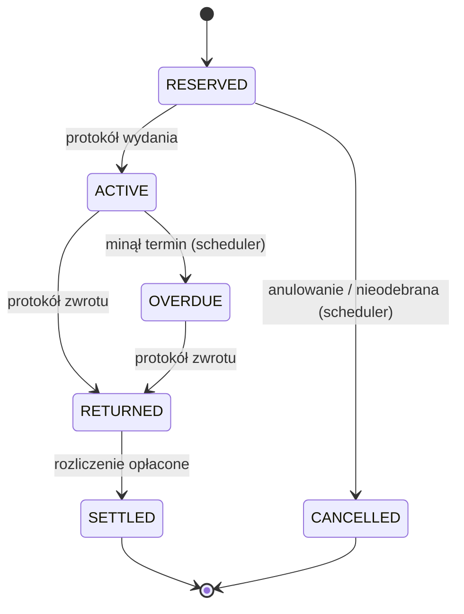
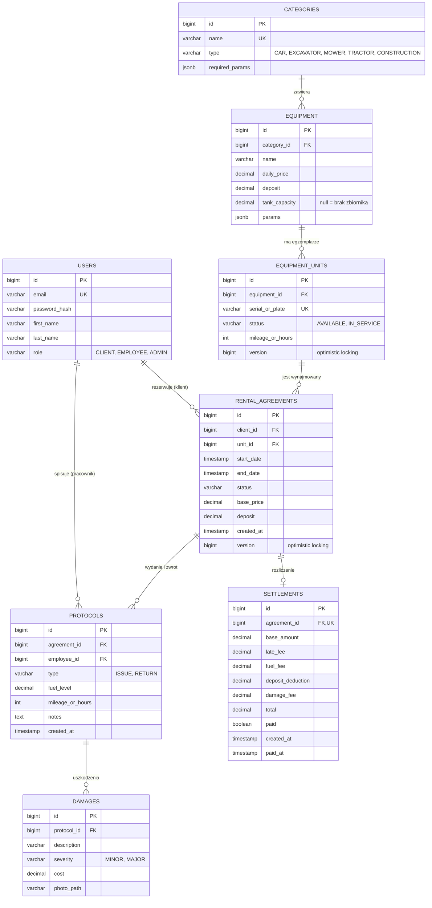

# RentEngine

[](https://github.com/Zabqus/RentEngine/actions/workflows/ci.yml)

Aplikacja webowa dla wypożyczalni samochodów i maszyn (minikoparki, kosiarki samojezdne, traktorki, maszyny budowlane). Obsługuje cały proces wynajmu: **rezerwacja → wydanie → zwrot → rozliczenie**.

Klient przegląda katalog i rezerwuje sprzęt na konkretny termin. Pracownik spisuje protokoły wydania i zwrotu (paliwo, przebieg lub motogodziny, uszkodzenia ze zdjęciami), a system sam wylicza rachunek z karami za spóźnienie, brakujące paliwo i szkody. O rezerwacjach, przeterminowaniu i rozliczeniu klient dostaje e-maile.

## Spis treści

- [Technologie](#technologie)
- [Uruchomienie](#uruchomienie)
- [Konta testowe](#konta-testowe)
- [Funkcjonalności](#funkcjonalności)
- [Reguły biznesowe](#reguły-biznesowe)
- [Model danych](#model-danych)
- [REST API](#rest-api)
- [Testy i CI](#testy-i-ci)
- [Struktura projektu](#struktura-projektu)
- [Demo](#demo)

## Technologie

| Warstwa | Technologie |
|---|---|
| Backend | Java 21, Spring Boot 4.1, Spring Web MVC, Spring Data JPA, Spring Security (JWT, jjwt), Bean Validation, Maven |
| Baza danych | PostgreSQL 17, migracje Flyway, parametry sprzętu w kolumnie JSONB |
| Frontend | React 19, TypeScript, Vite, MUI, React Router, TanStack Query, axios |
| Dokumentacja API | springdoc-openapi (Swagger UI) |
| Asynchroniczność | Spring Events + `@Async`, `@Scheduled`, Spring Mail, Mailpit (testowy serwer SMTP) |
| Testy | JUnit 5, Mockito, MockMvc, Testcontainers |
| Infrastruktura | Docker, Docker Compose, nginx, GitHub Actions |

## Uruchomienie

### Wymagania

- [Docker Desktop](https://www.docker.com/products/docker-desktop/) (lub Docker Engine z Compose v2)
- wolne porty: `3000`, `8080`, `5433`, `1025`, `8025` (można zmienić w `.env`)

### Start całej aplikacji

```bash
git clone https://github.com/Zabqus/RentEngine.git
cd RentEngine
cp .env.example .env
docker compose up --build
```

Pierwsze uruchomienie trwa kilka minut. Aplikacja jest gotowa, gdy wszystkie kontenery mają status `healthy` (`docker compose ps`). Baza startuje z przykładowymi danymi: 5 kategorii, 8 modeli sprzętu, 12 egzemplarzy i 4 konta.

| Co | Adres |
|---|---|
| Aplikacja (frontend) | http://localhost:3000 |
| Swagger UI (dokumentacja API) | http://localhost:8080/swagger-ui/index.html |
| Mailpit (podgląd wysłanych maili) | http://localhost:8025 |
| Healthcheck backendu | http://localhost:8080/actuator/health |

Zatrzymanie: `docker compose down`. Usunięcie także danych (baza, zdjęcia): `docker compose down -v`.

### Kontenery

| Kontener | Rola |
|---|---|
| `rentengine-db` | PostgreSQL 17, dane w wolumenie `postgres-data` |
| `rentengine-backend` | Spring Boot (REST API), zdjęcia uszkodzeń w wolumenie `uploads` |
| `rentengine-mailpit` | testowy serwer SMTP, łapie wszystkie maile |
| `rentengine-frontend` | nginx: serwuje React i przekazuje `/api` do backendu |

### Konfiguracja (`.env`)

Wartości z `.env.example` działają od razu. Przy prawdziwym wdrożeniu trzeba zmienić co najmniej `DB_PASSWORD` i `JWT_SECRET`.

| Zmienna | Opis | Domyślnie |
|---|---|---|
| `DB_NAME`, `DB_USER`, `DB_PASSWORD` | dane bazy | `rentengine` / `rentengine` / `change_me` |
| `DB_PORT` | port bazy na hoście | `5433` |
| `DB_URL` | JDBC URL do uruchamiania backendu poza Dockerem | `jdbc:postgresql://localhost:5433/rentengine` |
| `JWT_SECRET` | klucz podpisu tokenów, min. 32 znaki | wartość przykładowa |
| `JWT_EXPIRATION` | ważność tokena (ISO-8601) | `PT24H` |
| `MAIL_HOST`, `MAIL_PORT`, `MAIL_FROM` | serwer SMTP i nadawca | Mailpit, `1025` |
| `FUEL_PRICE` | cena litra paliwa doliczana za braki przy zwrocie | `7.00` |
| `BACKEND_PORT`, `FRONTEND_PORT` | porty na hoście | `8080`, `3000` |
| `TZ` | strefa czasowa backendu w kontenerze | `Europe/Warsaw` |

Opcjonalnie: `PICKUP_GRACE` (po jakim czasie nieodebrana rezerwacja jest anulowana, domyślnie `PT24H`), `SCHEDULER_CRON` (domyślnie co 5 minut), `MAIL_ENABLED`, `SCHEDULER_ENABLED`.

### Tryb deweloperski (bez budowania obrazów)

```bash
docker compose up -d postgres mailpit   # sama baza i SMTP

cd backend
./mvnw spring-boot:run                  # API na :8080, czyta ../.env

cd ../frontend
npm install
npm run dev                             # http://localhost:5173, /api idzie przez proxy Vite na :8080
```

W katalogu `http/` są gotowe zapytania dla HTTP Client w IntelliJ (środowisko `dev`). Najpierw trzeba uruchomić logowania z `auth.http`, które zapisują tokeny dla każdej roli.

## Konta testowe

| Rola | E-mail | Hasło |
|---|---|---|
| Klient | `client@rentengine.local` | `Client123!` |
| Klient (drugi) | `client2@rentengine.local` | `Client123!` |
| Pracownik | `employee@rentengine.local` | `Employee123!` |
| Administrator | `admin@rentengine.local` | `Admin123!` |

Nowe konto klienta można też założyć przez formularz rejestracji.

## Funkcjonalności

### Role

| Rola | Uprawnienia |
|---|---|
| Gość | przegląda katalog i szczegóły sprzętu, zakłada konto |
| `CLIENT` | rezerwuje sprzęt, widzi swoje umowy i rozliczenia, anuluje rezerwacje |
| `EMPLOYEE` | widzi wszystkie umowy, spisuje protokoły wydania i zwrotu, zgłasza uszkodzenia ze zdjęciami, generuje rozliczenia i oznacza je jako opłacone |
| `ADMIN` | zarządza sprzętem, egzemplarzami (w tym serwisem) i użytkownikami, anuluje rezerwacje, oznacza rozliczenia jako opłacone |

### Najważniejsze funkcje

1. **Katalog**: parametry zależne od kategorii (np. skrzynia biegów dla aut, głębokość kopania dla koparek), filtrowanie po kategorii, cenie i wolnym terminie, wyszukiwanie po nazwie, sortowanie i paginacja.
2. **Rezerwacje**: wybór egzemplarza i terminu z wyceną na żywo. System pilnuje dostępności i chroni przed podwójną rezerwacją przy równoczesnych żądaniach (optimistic locking).
3. **Protokoły wydania i zwrotu**: poziom paliwa, przebieg lub motogodziny, uwagi i uszkodzenia ze zdjęciami (JPEG/PNG do 5 MB, sprawdzane po zawartości pliku).
4. **Rozliczenie**: automatyczne wyliczenie kwoty za wynajem, kary za spóźnienie, brakującego paliwa i szkód, z rozbiciem na część pokrytą z kaucji, nadwyżkę i kaucję do zwrotu.
5. **Powiadomienia e-mail** (asynchronicznie, po zatwierdzeniu transakcji): potwierdzenie rezerwacji, przeterminowanie, anulowanie nieodebranej rezerwacji, rozliczenie. Awaria serwera SMTP nie blokuje operacji.
6. **Scheduler**: co 5 minut oznacza umowy po terminie jako przeterminowane i anuluje rezerwacje nieodebrane w ciągu 24 h.
7. **Panel administratora**: CRUD sprzętu, egzemplarzy i użytkowników, przełączanie egzemplarza między serwisem a dostępnością.
8. **Obsługa błędów**: API zwraca błędy w formacie `ProblemDetail` (RFC 9457) z kodem reguły (`code`) i mapą błędów pól (`errors`), a frontend tłumaczy je na polskie komunikaty.

## Reguły biznesowe

| | Reguła |
|---|---|
| **R1** | Nie można zarezerwować egzemplarza zajętego w danym terminie (`UNIT_NOT_AVAILABLE`). |
| **R2** | Nie można wypożyczyć egzemplarza w serwisie (`UNIT_IN_SERVICE`). |
| **R3** | Za każdą rozpoczętą dobę spóźnienia doliczane jest +10% stawki dobowej. |
| **R4** | Brakujące paliwo przy zwrocie jest doliczane do rachunku (litry × `FUEL_PRICE`). |
| **R5** | Koszt nowych uszkodzeń jest potrącany z kaucji, a nadwyżka trafia na rachunek. |
| **R6** | Klient z nieopłaconym rozliczeniem nie może zarezerwować kolejnego sprzętu (`UNPAID_SETTLEMENT`). |
| **R7** | Poważne uszkodzenie (`MAJOR`) automatycznie wysyła egzemplarz do serwisu. |
| **R8** | Umowa przechodzi tylko przez dozwolone statusy (diagram niżej), inne przejścia dają `INVALID_STATUS_TRANSITION`. |

Każda rozpoczęta doba najmu liczy się jako pełna (24 h 1 min = 2 doby).



## Model danych



Parametry zależne od kategorii są zapisane w kolumnie JSONB. Serwis sprawdza, czy sprzęt ma wszystkie parametry wymagane przez swoją kategorię (`required_params`). Schemat bazy tworzą migracje Flyway (`backend/src/main/resources/db/migration`, V1–V7, w tym dane przykładowe).

## REST API

Pełna, interaktywna dokumentacja jest w **Swagger UI**: http://localhost:8080/swagger-ui/index.html. Żeby wywołać chroniony endpoint, zaloguj się przez `POST /api/auth/login`, skopiuj `accessToken` i wklej go w przycisku **Authorize**.

Uwierzytelnianie: nagłówek `Authorization: Bearer <token>` (JWT, ważny 24 h). Listy są stronicowane (`page` od 0, `size` maks. 100, `sort=pole,asc|desc`) i zwracają obiekt `{ content, page, size, totalElements, totalPages, first, last }`.

| Metoda | Ścieżka | Dostęp | Opis |
|---|---|---|---|
| POST | `/api/auth/register` | publiczny | rejestracja klienta, zwraca token |
| POST | `/api/auth/login` | publiczny | logowanie, zwraca token |
| GET | `/api/categories`, `/api/categories/{id}` | publiczny | kategorie |
| POST, PUT, DELETE | `/api/categories/{id}` | ADMIN | zarządzanie kategoriami |
| GET | `/api/equipment?categoryId=&q=&minPrice=&maxPrice=&from=&to=` | publiczny | katalog z filtrami (stronicowany) |
| GET | `/api/equipment/{id}` | publiczny | szczegóły sprzętu |
| POST, PUT, DELETE | `/api/equipment/{id}` | ADMIN | zarządzanie sprzętem |
| GET | `/api/units?equipmentId=`, `/api/units/{id}` | publiczny | egzemplarze |
| POST, PUT, DELETE | `/api/units/{id}` | ADMIN | zarządzanie egzemplarzami |
| PATCH | `/api/units/{id}/status` | ADMIN, EMPLOYEE | serwis ↔ dostępny |
| POST | `/api/rentals` | CLIENT | rezerwacja |
| GET | `/api/rentals/my?status=` | CLIENT | moje umowy (stronicowane) |
| GET | `/api/rentals?status=&clientId=&unitId=` | EMPLOYEE, ADMIN | wszystkie umowy (stronicowane) |
| GET | `/api/rentals/{id}` | zalogowany (klient tylko swoje) | szczegóły umowy |
| PATCH | `/api/rentals/{id}/cancel` | CLIENT (swoje), ADMIN | anulowanie rezerwacji |
| GET | `/api/rentals/{id}/protocols` | zalogowany (klient tylko swoje) | protokoły z uszkodzeniami |
| POST | `/api/rentals/{id}/protocols` | EMPLOYEE | protokół wydania lub zwrotu |
| POST | `/api/protocols/{id}/damages` | EMPLOYEE | dodanie uszkodzenia |
| PUT | `/api/damages/{id}/photo` | EMPLOYEE | zdjęcie uszkodzenia (multipart, pole `photo`) |
| GET | `/api/damages/{id}/photo` | zalogowany (klient tylko swoje) | pobranie zdjęcia |
| POST | `/api/rentals/{id}/settlement` | EMPLOYEE | wygenerowanie rozliczenia |
| GET | `/api/rentals/{id}/settlement` | zalogowany (klient tylko swoje) | podgląd rozliczenia |
| PATCH | `/api/settlements/{id}/pay` | EMPLOYEE, ADMIN | oznaczenie rozliczenia jako opłacone |
| GET, POST, PUT, DELETE | `/api/users/{id}` | ADMIN | zarządzanie użytkownikami |

### Format błędów

```json
{
  "title": "Business rule violated",
  "status": 409,
  "detail": "Unit 'BOB-E35-0001' is already booked in this period",
  "instance": "/api/rentals",
  "code": "UNIT_NOT_AVAILABLE"
}
```

| Status | Kiedy |
|---|---|
| 400 | błędna walidacja, w polu `errors` mapa `pole → komunikat` |
| 401 | brak, nieważny lub wygasły token, złe hasło |
| 403 | brak uprawnień roli albo cudza umowa |
| 404 | nie znaleziono zasobu |
| 409 | naruszenie reguły biznesowej (pole `code`) albo równoczesna modyfikacja |
| 413 | za duży plik |

## Testy i CI

```bash
cd backend
./mvnw test
```

Testy integracyjne uruchamiają PostgreSQL w kontenerze (Testcontainers), więc wymagają działającego Dockera. Jest ich ok. 150 i obejmują m.in.:

- **logikę biznesową**: `PricingCalculatorTest` (doby, kary, paliwo, kaucja), `RentalServiceTest`, `ProtocolServiceTest`, `SettlementServiceTest`, `RentalAgreementStatusTest` (maszyna stanów), `RentalMaintenanceServiceTest` (scheduler);
- **integrację**: `RentalLifecycleIntegrationTest` (pełny cykl umowy), `RentalConcurrencyTest` (optimistic locking), `ApiSecurityIntegrationTest` (role i JWT), `NotificationIntegrationTest` (mail po commicie w osobnym wątku), `CatalogRepositoryTest` (JSONB);
- **warstwę web**: `GlobalExceptionHandlerTest`, `SecurityConfigTest`.

GitHub Actions (`.github/workflows/ci.yml`) przy każdym pushu i pull requeście na `main` buduje backend, uruchamia wszystkie testy i buduje obraz Dockera backendu.

## Struktura projektu

```
RentEngine/
├── backend/                  Spring Boot (Maven)
│   └── src/main/java/com/wzabek/rentengine/
│       ├── catalog/          kategorie, sprzęt, egzemplarze
│       ├── rental/           rezerwacje, umowy, statusy, scheduler
│       ├── protocol/         protokoły, uszkodzenia, zdjęcia
│       ├── settlement/       rozliczenia, PricingCalculator
│       ├── user/             użytkownicy, logowanie, JWT
│       ├── notification/     eventy, listener @Async, maile
│       └── common/           konfiguracja, wyjątki, obsługa błędów
├── frontend/                 React + TypeScript (Vite)
│   └── src/
│       ├── api/              klient axios i wywołania REST
│       ├── auth/             sesja, role, chronione trasy
│       ├── components/       wspólne komponenty i okna dialogowe
│       ├── pages/            strony aplikacji
│       └── notifications/    globalne komunikaty (toasty)
├── http/                     przykładowe zapytania (IntelliJ HTTP Client)
├── .github/workflows/ci.yml  CI
├── docker-compose.yml
└── .env.example
```

Każdy moduł backendu ma ten sam podział: `controller`, `service`, `repository`, `dto`, `entity`, `mapper`. Logika biznesowa jest w serwisach i w `PricingCalculator` (czysta klasa bez zależności od Springa), a kontrolery tylko mapują HTTP.

## Demo

Nagranie pokazujące działanie aplikacji jest w [`demo/rentengine-demo.mp4`](demo/rentengine-demo.mp4): katalog, rezerwacja i anulowanie, wydanie, przeterminowanie umowy, zwrot z uszkodzeniem, rozliczenie, e-maile w Mailpit i panel administratora.
